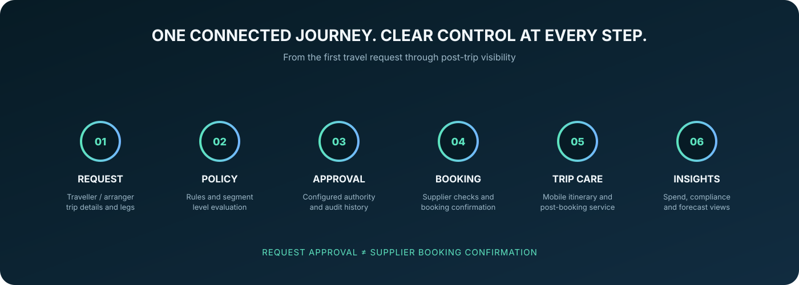
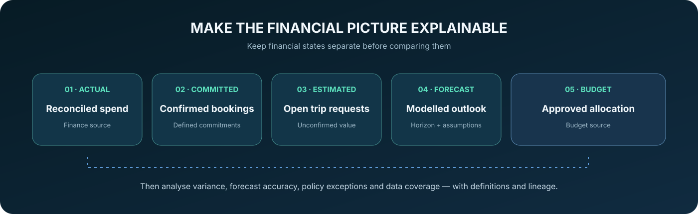

  
   

  
  
  
  

<h1 align="center">Designing a connected, policy-aware corporate travel experience.</h1>

  A product management portfolio covering the full business travel lifecycle — from trip request and policy evaluation to approval, supplier booking, mobile trip management and spend intelligence.

  <a href="#-explore-the-product">Explore the product</a> ·
  <a href="#-featured-product-capabilities">Capabilities</a> ·
  <a href="#-product-documentation">Documentation</a> ·
  <a href="#-connect">Connect</a>

---

## ✦ Product overview

Corporate travel involves more than finding a flight or hotel. Employees, travel arrangers, approvers, operations teams and finance stakeholders need a connected experience with clear controls and reliable status across the entire trip lifecycle.

This portfolio explores how a corporate travel management platform could bring those workflows together while accounting for enterprise policies, supplier dependencies, complex international itineraries and financial visibility.

  

## ◈ The product experience

<table>
  <tr>
    <td width="50%">
      <h3>✈️ Travel request &amp; approval</h3>
      
Guided trip requests, delegated booking, cost allocation, policy evaluation and configurable approval workflows.

      <a href="workflows/travel-request-and-approval.md">Explore workflow →</a>
    </td>
    <td width="50%">
      <h3>🛡️ Corporate travel policy</h3>
      
Versioned rules, segment-aware evaluation, explainable outcomes, exceptions and governance controls.

      <a href="workflows/policy-engine.md">Explore policy engine →</a>
    </td>
  </tr>
  <tr>
    <td width="50%">
      <h3>🌍 Multi-city &amp; international trips</h3>
      
One parent trip with ordered legs, time-zone accuracy, local currency context and component-level booking status.

      <a href="workflows/multi-city-international-travel.md">Explore complex travel →</a>
    </td>
    <td width="50%">
      <h3>📱 Mobile trip management</h3>
      
Trip overview, itinerary access, supported service actions, secure notifications and transparent low-connectivity behaviour.

      <a href="workflows/mobile-trip-management.md">Explore mobile experience →</a>
    </td>
  </tr>
  <tr>
    <td width="50%">
      <h3>🔗 Supplier booking &amp; servicing</h3>
      
Price revalidation, supplier response mapping, ticketing states, duplicate-safe processing and reconciliation.

      <a href="workflows/booking-lifecycle.md">Explore booking lifecycle →</a>
    </td>
    <td width="50%">
      <h3>📊 Spend intelligence</h3>
      
Distinct actual, committed, estimated, forecast and budget views, with explainable policy insights.

      <a href="analytics/spend-forecasting-and-policy-insights.md">Explore spend insights →</a>
    </td>
  </tr>
</table>

## ✧ Featured product models

### 1. Booking lifecycle: make status trustworthy

Approval of a travel request is not the same as supplier booking confirmation. The product model separates internal approval from supplier-side booking, ticketing and cancellation states. Unknown outcomes require reconciliation rather than an unsafe blind retry.

[Read the booking lifecycle](workflows/booking-lifecycle.md) · [Review integration design](integrations/integration-overview.md)

### 2. Spend intelligence: make numbers interpretable

  

The reporting model distinguishes financial states before showing variance or trends. Forecasts remain estimates; they do not replace the finance system of record or silently change policy.

[Read spend forecasting and policy insights](analytics/spend-forecasting-and-policy-insights.md)

## ⌘ Product documentation

| PRODUCT AREA | ARTEFACTS | OPEN |
|---|---|---|
| **Strategy** | Vision, product goals and candidate KPIs | [Strategy docs →](docs/) |
| **Discovery** | Persona hypotheses and research plan | [Discovery docs →](discovery/) |
| **Requirements** | PRD, functional requirements, user stories and acceptance criteria | [Requirements →](requirements/) |
| **Workflows** | Request / approval, policy, booking, multi-city and mobile journeys | [Workflow docs →](workflows/) |
| **Integrations** | Enterprise integration landscape and design questions | [Integration docs →](integrations/) |
| **Analytics** | Metrics catalogue, event tracking and spend forecasting | [Analytics docs →](analytics/) |
| **Delivery** | Outcome-oriented roadmap and release sequencing | [Roadmap →](delivery/roadmap.md) |
| **Governance** | Product risks and control considerations | [Governance docs →](governance/) |
| **Templates** | Reusable product decision artefacts | [Templates →](templates/) |

### Start with these artefacts

- [Product Requirements Document](requirements/PRD.md)
- [Personas](discovery/personas.md)
- [Discovery research plan](discovery/research-plan.md)
- [Functional requirements](requirements/functional-requirements.md)
- [User stories](requirements/user-stories.md)
- [Acceptance criteria](requirements/acceptance-criteria.md)
- [Travel request and approval](workflows/travel-request-and-approval.md)
- [Supplier integration overview](integrations/integration-overview.md)
- [Product metrics catalogue](analytics/metrics-catalogue.md)
- [Event tracking plan](analytics/event-tracking-plan.md)
- [Product roadmap](delivery/roadmap.md)
- [Risk register](governance/risk-register.md)

## ◉ Product strategy & measurement

**Candidate North Star metric:** successful policy-compliant business trips per eligible traveller.

This measure should be interpreted alongside traveller satisfaction, booking reliability, cost, service quality and operational guardrails. It is a proposed product metric, not a measured result.

| Product objective | Candidate measures |
|---|---|
| Reduce request friction | Request completion rate; incomplete request rate |
| Improve approval flow | Approval turnaround; time in each approval stage |
| Strengthen policy clarity | Policy exception rate; repeat exception reasons |
| Improve booking reliability | Supplier-confirmed booking rate; unknown outcome rate |
| Support complex travel | Multi-city trip completion; international request completion |
| Improve mobile usefulness | Mobile task completion; notification delivery; stale itinerary access |
| Improve financial visibility | Forecast variance and accuracy; cost allocation completeness |
| Improve service operations | Service resolution time; support contacts per trip |

Final metric definitions, denominators, eligibility rules, baselines and targets must be agreed before reporting. See the [metrics catalogue](analytics/metrics-catalogue.md).

## ◇ Product principles

- **Traveller-first, policy-aware:** make the compliant path understandable without hiding valid alternatives.
- **Approval is not confirmation:** keep request, approval, booking and ticketing states distinct.
- **Reliable by design:** define timeout, duplicate callback, partial confirmation and reconciliation behaviour.
- **International-ready:** preserve local time zones, date boundaries and currency context.
- **Operationally transparent:** show ownership, status, supplier references and next action.
- **Finance-aware:** distinguish actual, committed, estimated, forecast and budget amounts.
- **Secure by default:** apply least privilege, data minimisation, auditability and safe notification practices.
- **Evidence-led:** measure user and business outcomes before setting targets or making policy recommendations.

## 🧭 How to navigate this portfolio

1. Start with the [Product Requirements Document](requirements/PRD.md) for scope, goals, user roles and business rules.
2. Review [personas](discovery/personas.md) and the [research plan](discovery/research-plan.md) to understand discovery assumptions.
3. Follow the [request and approval](workflows/travel-request-and-approval.md) and [policy engine](workflows/policy-engine.md) workflows.
4. Explore the [booking lifecycle](workflows/booking-lifecycle.md) and [integration landscape](integrations/integration-overview.md).
5. Review [mobile trip management](workflows/mobile-trip-management.md) and [spend intelligence](analytics/spend-forecasting-and-policy-insights.md).
6. Finish with the [roadmap](delivery/roadmap.md), [metrics](analytics/metrics-catalogue.md) and [risk register](governance/risk-register.md).

## ◌ Portfolio disclosure & responsible use

This repository is a **reference product case study and sample product documentation**. It is not a representation of a specific employer's confidential platform, customer configuration or production architecture.

- Workflows, requirements, diagrams, targets and assumptions are portfolio examples to support discussion and must be validated before implementation.
- Candidate KPIs are proposed definitions; no unverified performance results are claimed.
- No real customer, employee, traveller or supplier data is intentionally included.
- Product capabilities are described as a conceptual scope, not as a claim that a complete platform has been built or launched.
- Do not use the examples as legal, immigration, security or financial advice.

## ↗ Connect

  
  
  
  

Created by <strong>Nithin Ravindran</strong> · Corporate Travel Product Management Portfolio

