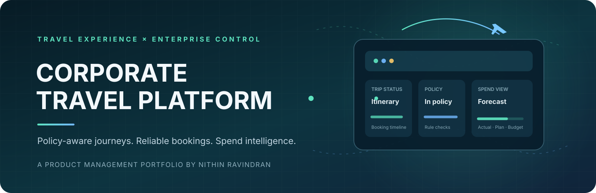

**Corporate Travel Management · Product Strategy · Workflow Design**

[Main Portfolio](https://github.com/NithinRavindran/Portfolio) · [Product Case Studies](https://github.com/NithinRavindran/PM) · [LinkedIn](https://www.linkedin.com/in/nithin-ravindran-422895103/)

---

# Corporate Travel Platform

**Product Management Portfolio | Corporate Travel Management (CTM)**

A product-focused portfolio for a corporate travel platform that helps organisations manage employee business travel from request and policy validation through approval, booking, trip servicing, mobile trip management and spend intelligence.

This repository demonstrates product management across discovery, strategy, requirements, workflow design, supplier integrations, analytics, delivery and governance.

> **Portfolio disclosure:** This is a reference product case study and sample product documentation. It is not a representation of a specific employer's confidential platform, customer configuration or production architecture. All sample workflows, targets and assumptions must be validated before implementation. No actual customer data or production metrics are included.

## Product scope

### Core corporate travel capabilities
- Employee and traveller profiles.
- Travel arranger and delegated booking.
- Corporate travel policy and compliance rules.
- Trip requests and configurable approval workflows.
- Flight and hotel search, selection and booking.
- Supplier integrations and booking status orchestration.
- Itinerary management, amendments, cancellations and post-booking servicing.
- Expense / finance hand-offs and reporting.
- Administration, permissions and auditability.

### Multi-city and international travel
- Multi-leg and multi-destination trip requests.
- Segment-level flight, hotel and ground transport planning.
- Cross-border itinerary validation and travel-policy evaluation.
- Local currency display, base-currency conversion and exchange-rate timestamping.
- Local time zones, date-boundary handling and overnight connections.
- International travel document and destination-information reminders, based on organisation-approved data and policies.
- Separate approval, booking and servicing status for each trip component.

### Mobile trip management
- Mobile-responsive traveller trip workspace.
- Upcoming-trip overview, itinerary and booking references.
- Mobile access to approval and booking status.
- Trip change / cancellation request initiation where supplier capability allows.
- Push / in-app notifications for approvals, booking changes and disruption updates.
- Secure access, role-aware data visibility and session controls.
- Essential itinerary access in low-connectivity scenarios where secure caching is supported and approved.

### Advanced spend forecasting and policy insights
- Forecast travel spend by entity, department, cost centre, traveller segment, destination and travel category.
- Compare actual, booked / committed, estimated and budgeted spend.
- Forecast variance and confidence indicators with visible assumptions.
- Policy compliance and exception trends by rule, business unit and travel category.
- Identify recurring out-of-policy reasons, approval bottlenecks and supplier / category patterns.
- Provide evidence-led recommendations for policy review; policy changes remain under authorised administrator control.

## Repository map

| Area | Contents |
|---|---|
| [Product strategy](docs/) | Vision, problem statement, goals and KPIs |
| [Discovery](discovery/) | Personas, journeys and research plan |
| [Requirements](requirements/) | PRD, functional requirements, user stories and acceptance criteria |
| [Workflows](workflows/) | Request-to-approval, policy engine, booking lifecycle, servicing, multi-city travel and trip management |
| [Integrations](integrations/) | Integration landscape, supplier APIs, finance / HR data and mobile notifications |
| [Analytics](analytics/) | Product metrics, spend forecasting and event tracking |
| [Delivery](delivery/) | Outcome-based roadmap, UAT and release readiness |
| [Governance](governance/) | Risk register and decision log |
| [Templates](templates/) | Reusable product decision template |

## Product north star

**Successful policy-compliant business trips per eligible traveller** is a candidate North Star metric because it combines completed travel outcomes with policy compliance. It must be interpreted alongside traveller satisfaction, booking reliability, cost, forecast accuracy and support guardrails.

## End-to-end product journey

1. Organisation configures entities, traveller access, policy rules, budgets, approval paths and reporting dimensions.
2. Employee or travel arranger creates a domestic, international or multi-city trip request.
3. Platform validates trip segments, required information and applicable policy rules.
4. Request is auto-approved or routed to the configured approver(s).
5. Traveller or arranger searches and selects eligible flight / hotel options for relevant trip legs.
6. Platform validates price and availability, then submits booking requests to suppliers.
7. Traveller manages the itinerary through web or mobile, with component-level booking and service status.
8. Changes, cancellations and disruptions are handled with supplier rules and auditable status updates.
9. Travel and finance teams review actual and committed spend, forecasts, policy insights and operational metrics.

## Key product principles

- **Traveller experience:** minimise friction across desktop and mobile while keeping policies understandable.
- **Policy transparency:** explain why an option is compliant or requires an exception.
- **Reliable booking:** distinguish request approval from supplier confirmation and track each itinerary component.
- **International readiness:** handle time zones, local currencies, destination context and multi-leg journeys clearly.
- **Operational control:** make ownership, exception status and next action visible.
- **Integration resilience:** handle timeouts, retries, duplicate callbacks and reconciliation safely.
- **Privacy and security:** apply least-privilege access and minimise personal data.
- **Evidence-led insights:** show forecast assumptions, confidence and policy analytics without silently changing rules.
- **Measurable outcomes:** define metrics and event semantics before rollout.

## Start here

- [Product Requirements Document](requirements/PRD.md)
- [Personas](discovery/personas.md)
- [Travel request and approval workflow](workflows/travel-request-and-approval.md)
- [Corporate policy engine](workflows/policy-engine.md)
- [Multi-city and international travel](workflows/multi-city-international-travel.md)
- [Mobile trip management](workflows/mobile-trip-management.md)
- [Spend forecasting and policy insights](analytics/spend-forecasting-and-policy-insights.md)
- [Booking lifecycle](workflows/booking-lifecycle.md)
- [Supplier integration overview](integrations/integration-overview.md)
- [Product metrics catalogue](analytics/metrics-catalogue.md)
- [Product roadmap](delivery/roadmap.md)

## Maintainer

Nithin Ravindran · [GitHub](https://github.com/NithinRavindran) · [LinkedIn](https://www.linkedin.com/in/nithin-ravindran-422895103/) · [Portfolio](https://github.com/NithinRavindran/Portfolio)
